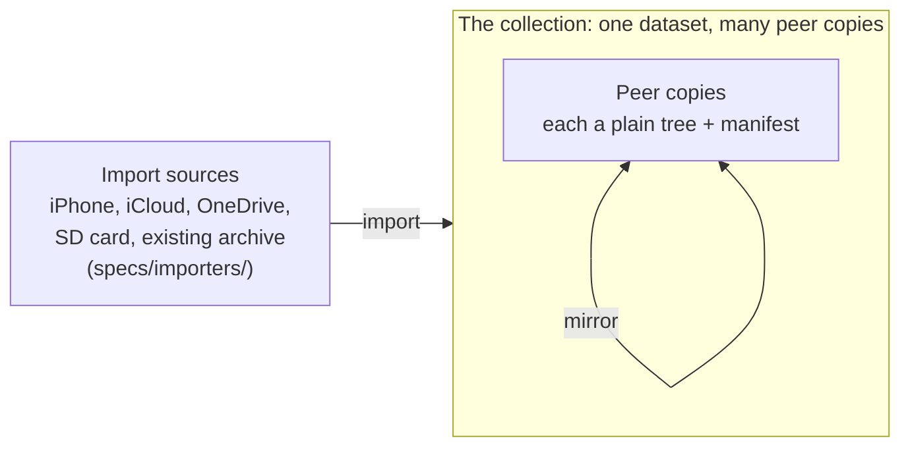

# Turbo-Collection: Specification (Core)

> **Spec version:** 0.1.0-draft  
> **Created:** 2026-07-12  
> **Status:** Draft.

This document is the **normative source of truth** for what Turbo-Collection
must do. It is language-neutral and tool-neutral on purpose, so that the tests
and the implementation can be regenerated from it in any future implementation
language, in the way an RFC outlives any single implementation of a protocol.

This document carries its **own** glossary (Section 3), and does not defer it
elsewhere. Which document binds what, that the documents binding the
implementation are jointly sufficient, and how code cites and traces to them,
are governed by `traceability-requirement.md` (`R-META-*`). Which other
documents exist, and what each one governs, is mapped in `docs/spec-guide.md`,
which is navigation and binds nothing, so no obligation here depends on it.

This document is written across several files: this one,
`turbo-collection-core-spec.md`, `init-spec.md`, `import-spec.md`,
`backup-spec.md`, `verify-spec.md`, `logging-spec.md` and
`parallel-safety-spec.md`. Each of the others is a part of this document. Its
version is this document's version, decided under Section 9.2, and its section
numbers continue this document's.

---

## 1. Scope, Non-Goals, and Invocation

The diagram below _is_ Turbo-Collection's scope statement. It draws the line
between what this document owns, what the import source specifications own, and
what sits outside Turbo-Collection entirely.

Every Copy is a plain tree carrying its own manifest, verifiable against it
independently and reachable as files on its medium (R-TGT-9). **Copies are
peers: no copy is privileged.** Mirroring is symmetric and add-only, filling
whichever copy lacks a file another holds, in whichever direction each file
needs; on a mismatch neither side is authoritative (R-INT-7). Fixity (checksum),
not location, is what establishes that data is intact.

### 1.1 In Scope

The durable Core: Import contract, Storage layout contract, Mirror semantics,
integrity, filename safety, meta file versioning, configuration, logging, and
the command-line contract. |

### 1.3 Non-Goals (normative)

Turbo-Collection does **not** do the following, and MUST NOT grow them by
accident. Each has a documented path to becoming a goal later, in Section 10, so
that deferring them costs no architectural flexibility.

| Non-goal                                                     | Path to enabling it |
| ------------------------------------------------------------ | ------------------- |
| Albums and tags                                              | Section 10          |
| Captions, ratings, face recognition                          | Section 10          |
| Converting a Content file to an open format                  | Section 10          |
| AI search                                                    | Section 10          |
| A browsing graphical interface                               | Section 10          |
| Versioning and snapshots _of the collection_                 | Section 10          |
| Deduplication                                                | Section 10          |
| Modifying a file in place: restore, repair, manifest rebuild | Section 10          |
| Symbolic links and other entries that are not regular files  | Section 10          |

> These are non-goals, not rejections. The distinction matters: a rejection
> means the idea is wrong, and a non-goal means it is simply not being built
> yet. Section 10 exists to prove the difference is real, by showing exactly
> what each would cost.

### 1.4 Invocation is External

Turbo-Collection is invoked from outside: by **a human on demand**, or by **an
OS scheduler**. Both are equal citizens, and both live outside the system.
Turbo-Collection contains no scheduling logic (R-CLI-2) and is fully usable with
no scheduler installed at all (R-CLI-6).

---

## 2. Guiding principles (normative)

These are the principles the requirements are derived from. Where a requirement
seems to conflict with a principle, the conflict is a defect, and one of the two
must change.

The project-wide durability axioms (plain data, redundancy, re-verification,
explicit guarantees, recoverability, and never destroying preserved data) are
requirements in `durability-requirement.md` (`R-DUR-*`). The two principles
below are specific to Turbo-Collection's own architecture.

- **The Core is indifferent to Importers**  
  The Core knows nothing about how a file arrived. It knows only the collection:
  plain trees and their manifests. Every fact about where a file came from lives
  in the importer that brought it in; none lives in the core.

- **A Record lives with the data it describes, never in a separate index.**
  There is no central database of what is stored where. A directory carries its
  own manifest (R-MFILE-8) and its own receipt (R-MFILE-13); every copy carries
  its own configuration stating what it is (R-MFILE-19), and optionally its own
  copy of this document (R-VER-8); no memory of an import source is kept between
  runs (R-SRC-13). A separated directory therefore stays interpretable, and
  there is no index whose loss makes surviving media unreadable. The cost is
  accepted deliberately: records are repeated across copies rather than
  centralized, which is redundancy (`R-DUR-2`) applied to metadata.

---

## 3. Terminology

Self-contained, per `language-requirement.md` R-LANG-5.

- **Turbo-Collection**  
  This system: the orchestrator, its importers, its copies' storage, and its
  mirror engine.

- **Collection**  
  The set of files this project preserves: photographs and videos, and any other
  file an import brings in (R-SRC-20). It is one logical dataset, held as one or
  more **peer copies**, each a plain tree (R-COL-1). This is the data
  Turbo-Collection exists to protect. (The word "library" is deliberately
  avoided, because it collides with "code library".)

- **Layout**  
  A rule that determines where in the collection a content file is stored, given
  that file's own bytes, the metadata its import source supplied with it, and
  that import source.

- **Procedure**  
  A normative document stating the steps a Human operator performs to achieve a
  result this specification requires. It binds the operator, not the
  implementation (R-META-4).

- **Init** v  
  The operation that creates a directory for a new copy with no other copy
  present, which is how a collection's first copy comes to exist (`init-spec.md`
  R-INIT-1).

- **Import** v  
  Bringing files into the collection Copy from an import source, performed by an
  importer.

- **Import Source**  
  One way of getting files into the Collection, such as iCloud or a camera card.
  An import source is an **instance**: a personal and a work iCloud account are
  two import sources, each named by the operator (`icloud-personal`,
  `icloud-work`). An importer imports from exactly one import source.

- **Importer**  
  The component that brings files into the Collection from one **Import
  Source**. An importer is internal to Turbo-Collection and reaches exactly one
  import source; an import source is the outside origin files are imported from.

- **Copy** n  
  One physical instance of the collection, held on one storage medium. Copies
  are **peers**: no copy is privileged, each carries its own manifest and is
  verifiable against it independently (R-TGT-9), and mirroring is symmetric
  among them.

- **Content File**  
  Any file a copy holds outside its `.turbo-collection/` directories that is
  neither a Meta file nor an Ignored file. Photographs and videos are one kind
  of content file; where each kind is placed is decided by layout specifications
  (R-SRC-15).

- **Meta File**  
  A file Turbo-Collection writes into a copy that describes that copy or what
  happened to it: the configuration file, the ignore file, a manifest, a
  receipt, and any copy of a specification carried on a drive.

- **Manifest File**  
  A JSON file recording a checksum for each file in one directory, together with
  the hash algorithm and the versions of the specifications that directory was
  written under (R-MFILE-9).

- **Receipt File**  
  A per-directory record of the arrivals of that directory's content: where it
  came from, and the dated arrival of that content at each copy (R-MFILE-13). A
  manifest states what is present now and can be rebuilt by rescanning; a
  receipt states what happened and can be rebuilt from nothing.

- **Ignored File**  
  A file in a copy that matches a pattern in that copy's ignore file,
  `.tcignore` (`meta-file-spec.md` R-MFILE-20). Turbo-Collection records no
  ignored file in a manifest and mirrors none to another copy (R-MFILE-21).

- **Backup** v  
  The operation an operator runs to bring the collection's peer copies into
  agreement, so the collection survives the loss of any one copy (R-CLI-5). Its
  mechanism is a non-destructive, symmetric mirror across those copies
  (`backup-spec.md` Section 7.1); recovering data from a copy is _restore_. A
  backup given an empty directory, or one that does not exist, creates a new
  copy there (R-BACKUP-1); every copy after the first comes to exist this way.

- **Mirror** v  
  Additive only. The mirror is the mechanism the **backup** operation performs.

- **Status**  
  Quick statement about each Copy for the collection. Not, each file, just each
  full copy statement.

- **Verify**  
  Allows per file info about collection correctness.

- **Fixity**  
  Aka Checksum Evidence during Verify operation that data has not changed or
  corrupted, established by comparing checksums.

---

## 4. Collection Invariants (`R-COL-*`)

These constrain the collection itself. They outrank everything else in this
document: any requirement that conflicts with them is wrong and must be changed.

**R-COL-1.** The Collection MUST be a plain directory tree of ordinary files.
Turbo-Collection MUST NOT introduce a database, archive, container, or any other
format that requires software to read the files back.

**R-COL-2.** Turbo-Collection MUST preserve every Content file byte-for-byte,
exactly as an Importer supplied it. It MUST NOT transcode, recompress, resize,
or strip metadata from a Content file, under any circumstance.

**R-COL-3.** The Collection MUST remain fully usable without Turbo-Collection.
Any ordinary file manager or file-copy tool MUST be sufficient to browse it and
recover its contents.

**R-COL-4.** Every Copy MUST be a plain tree, laid out under the same layouts,
so that a Content file's path is derived the same way in every Copy. A Copy MAY
lack a Content file that another Copy holds: a file imported into one Copy and
not yet mirrored, or a file a person removed from one Copy. Turbo-Collection
resolves such a difference only by adding the file where it is absent
(R-BACKUP-4), never by deleting it where it is present (R-BACKUP-6).

> **Example.** A photo deleted by hand from one Copy is still in the others, and
> the next backup copies it back.

---

## 6. Layout (`R-TGT-*`)

What must hold of the Storage a copy sits on.

**R-TGT-1.** Turbo-Collection MUST read and write a Collection Copy as plain
files on that copy's medium. The Core MUST contain no logic specific to any
individual storage medium, vendor, or service.

**R-TGT-3.** Which copies a run acts on, and the storage settings each needs,
MUST be supplied to Turbo-Collection as data rather than hardcoded in code.

**R-TGT-4.** Multiple copies MUST be able to coexist and MUST be acted on
independently. The failure against one copy MUST NOT prevent the attempt against
another, and MUST still be reported.

**R-TGT-7.** A copy's storage MUST NOT modify, rename, move, or delete a file
already present in that copy, meta files included, except as R-TGT-13 states.
Writing a copy's receipt is the core's responsibility, never its storage's
(R-REC-6).

**R-TGT-9.** Each copy MUST carry, in each of its directories, a manifest
covering **that directory's own** contents (R-MFILE-8), so that the copy is
self-verifying without any other copy and without Turbo-Collection, and so that
any single directory remains verifiable when separated from the rest.

**R-TGT-11.** Every copy MUST be restorable by ordinary file copy, using no
Turbo-Collection software.

> **Example.** With Turbo-Collection gone, a finder restores a copy by copying
> its files off the drive with any file manager.

**R-TGT-13.** A Content File is in the Collection only once its directory's
manifest lists it. Turbo-Collection MUST add a Content File to that manifest
only once that file is completely written, and MAY write over a Content File
that its directory's manifest does not list.

> **Example.** An import stopped while it writes `IMG_0412.HEIC` leaves that
> file unlisted, so it is not in the Collection, and the next import writes it
> again.

---

## Status (`R-STATUS-*`)

**R-STATUS-1.**  
**Status Operation**  
Turbo-Collection MUST provide a read-only **status** operation that reports,
from receipts alone and with no other copy connected, which copies each
directory's content has reached, the date of each arrival, and the content
present that has reached no other copy. It MUST report every arrival's date
(R-REC-8), and MUST NOT state or imply that a copy still exists or is still
intact. A status MUST also report each connected Copy's `collectionName` and
`copyName` (`meta-file-spec.md` R-MFILE-18). What a status reports MUST NOT by
itself cause a non-zero exit status.

---

## 9. Versioning and change (`R-VER-*`)

This section governs how this specification's own version is decided (9.2), and
how meta files declare the version that governs them (9.3).

> **Where the rest of it went.** How a normative document in this project is
> numbered, published, archived, and corrected is stated in
> [`version-requirement.md`](version-requirement.md), which binds every
> normative document here, including this one. Those rules bind the authors of
> documents, and code has nothing to cite in them. Everything left in this
> section binds the implementation.

### 9.1 The regress, and where it stops

Code is regenerable from this specification, so code need not be preserved. But
**this specification changes too**, which appears to relocate the problem rather
than solve it: now we must know which version a meta file was written under, and
we must preserve the specification itself. That is a real objection, and it is
answered in three moves.

1. **The specification is a meta file, and it travels with the data.** Every
   copy carries the version it was written under (R-VER-8). It is a few tens of
   kilobytes against terabytes; redundancy (`R-DUR-2`) authorizes this without
   argument. The specification cannot float away into abstraction, and it cannot
   die with a code-hosting service: it survives as long as any copy of the
   collection survives.

2. **Meta files are self-_evident_, not merely self-_described_** (R-MFILE-6). A
   version stamp tells a reader _which rules applied_; it MUST NOT be the _key
   to decoding_. A manifest is plain JSON, naming each file beside its size and
   its checksum: it can be read by looking at it, with no specification in hand.
   So losing the specification entirely is survivable. This property is
   available only because every format is plain text, which is the payoff of the
   choice already made in R-COL-1.

3. **Versioning does not require a decoder.** RFCs _are_ versioned, and
   rigorously: each is immutable once published, and a later RFC explicitly
   obsoletes or updates an earlier one. What RFCs never needed was a _version of
   English_. That is the distinction that matters: a binary format's version
   tells you **which decoder to use**, so losing its specification destroys the
   data; a prose specification's version tells you **which document you are
   reading**, and you can read it regardless. The chain of versions terminates
   in something a human, or an AI, can simply read. The regress stops, and it
   stops because of what the meta files are made of, not because versioning was
   avoided.

### 9.2 Version of this specification

**R-VER-1.** The bump of this specification's semantic version MUST be decided
by the effect on **behavior**. **MAJOR**: previously conforming behavior becomes
forbidden; or a contract (`turbo-collection-core-spec.md` Section 11) changes so
that an existing importer, or existing storage support for a medium, stops
conforming; or the document language or obligation vocabulary changes
(`version-requirement.md` R-PUB-9). **MINOR**: additions only; everything
conforming under the previous version still conforms. **PATCH**: prose
improvement with no behavioral consequence. A change of meta file format is
measured by `meta-file-spec.md`, and a change of layout by the layout
specification it belongs to, under each of their own bump tests.

### 9.3 Stamps and self-evidence

**R-VER-8.** Every copy MUST record the version of every specification that
governed the writing of its content. Every copy SHOULD additionally carry the
text of each such specification, so that the rules governing the data survive
alongside the data; where carried, each MUST be named for the document and the
full version of the text it holds, as `turbo-collection-spec-<version>.md`.

**R-VER-9.** Code MUST declare the version of every specification it conforms
to, and every run MUST record those versions in its log (R-LOG-3).

**R-VER-18.** A version stamp MUST state the name of the document it stamps, and
the publication date in ISO 8601 form, beside the number: for example,
`turbo-collection-spec 1.2.0 (2027-03-01)`.

> **Rationale.** Why document-lifecycle rules moved to `version-requirement.md`,
> and why this document's number tracks behavior:
> [the version-requirement split decision](../docs/decisions/2026-08-01-version-requirement-split-decision.md)
> and
> [the future-reader decision](../docs/decisions/2026-08-16-future-reader-decision.md).

---

## 10. Extension points: the path from non-goal to goal

Section 1.3 lists what Turbo-Collection does not do. This section is the
evidence that deferring those things costs no architectural flexibility. For
each one: what enabling it would require, which existing requirement already
carries it, and **what would not change**.

The last column is the real deliverable. A claim that an architecture is
flexible is worth nothing; a demonstration of what a change would cost is worth
something.

| Deferred goal                                                   | Path to enabling it                                                                                                                                                                                                                                                                                                                                                                                                                                                                                                                                                                                                                                                                                                                            | Already provided by                       | Core changes needed                                                                                                                                                                                                  |
| --------------------------------------------------------------- | ---------------------------------------------------------------------------------------------------------------------------------------------------------------------------------------------------------------------------------------------------------------------------------------------------------------------------------------------------------------------------------------------------------------------------------------------------------------------------------------------------------------------------------------------------------------------------------------------------------------------------------------------------------------------------------------------------------------------------------------------- | ----------------------------------------- | -------------------------------------------------------------------------------------------------------------------------------------------------------------------------------------------------------------------- |
| **Albums and tags** (groupings)                                 | A grouping is a plain-text list of members. **R-COL-2 already pre-decides the hard part**: membership can never live inside a photo's own metadata, because Content files are immutable, so it must be an external plain file. The manifest format (R-MFILE-9) is already exactly the shape of a membership list, so a grouping is a _subset of a manifest_: there is no new format to invent, and a JSON manifest has room for the fields a grouping needs beyond membership, such as curated order. R-MFILE-8's per-file SHA-256 supplies a stable identity that survives renames and reorganization. Grouping files are ordinary files in the collection, so they are mirrored, checksummed, and verified by machinery that already exists. | R-COL-2, R-MFILE-8, R-MFILE-9, R-BACKUP-4 | **None in the core.** One extension to the import contract (`turbo-collection-core-spec.md` Section 11), so importers can report groupings. R-SRC-2 already anticipates exactly this.                                |
| **Captions, ratings, faces**                                    | The same shape: per-photo metadata in sidecar files beside the photo, never inside it (R-COL-2).                                                                                                                                                                                                                                                                                                                                                                                                                                                                                                                                                                                                                                               | R-COL-2                                   | None. Sidecars are ordinary files.                                                                                                                                                                                   |
| **Open-format conversions, and format-risk reporting**          | Proprietary formats (HEIC, HEVC, CR3, NEF, ARW) are a genuine long-term readability risk. A conversion step would write an open-format file rendered from each at-risk Content file, stored in addition to that file and never in place of it (R-COL-2), and a read-only report lists which formats in the collection are proprietary or single-vendor.                                                                                                                                                                                                                                                                                                                                                                                        | R-COL-2, R-MFILE-8                        | **One design, not yet made:** where a rendered file is stored, how it is identified as rendered, and whether it is mirrored or regenerated. The report needs no core change; it only reads data that already exists. |
| **Versioning and snapshots of the collection**                  | A copy using a repository format (restic, Borg, Kopia). **This is the one deferred goal that requires amending a requirement rather than merely adding storage support for a medium:** R-COL-4 would change from "every copy MUST be a plain tree" to "at least one copy MUST be", and a check that at least one copy is a plain tree would be added with that storage support.                                                                                                                                                                                                                                                                                                                                                                | R-TGT-1                                   | **One requirement amended (R-COL-4), one check added, storage support for one medium added.** No structural change.                                                                                                  |
| **Cloud off-site**                                              | A copy whose medium happens to be remote. It still stores one object per file, so it is a plain tree and satisfies R-COL-4 **today**, with no amendment at all.                                                                                                                                                                                                                                                                                                                                                                                                                                                                                                                                                                                | R-TGT-1                                   | None. Storage support for one more medium.                                                                                                                                                                           |
| **Deduplication**                                               | The manifest already holds a content hash for every file, so duplicate detection is a read-only report over data that already exists. Deliberately deferred: redundancy (`R-DUR-2`) holds that duplicates are cheap and often desirable.                                                                                                                                                                                                                                                                                                                                                                                                                                                                                                       | R-MFILE-8                                 | None.                                                                                                                                                                                                                |
| **Restore, repair, and manifest rebuild**                       | Each would modify or replace a file already in a copy, which no operation does today (R-BACKUP-5, R-TGT-7). Until one is built, recovery is an ordinary file copy with any file manager (R-TGT-11), and choosing which copy survives a mismatch is a human decision (R-INT-7). Existing requirements already fix the shape such an operation would take: a separate action a human explicitly requests (R-INT-6), reporting every difference rather than overwriting silently (R-INT-10).                                                                                                                                                                                                                                                      | R-INT-6, R-INT-7, R-INT-10, R-TGT-11      | None to the plain tree. One operation added; whether it may overwrite a content file is the decision deferred with it.                                                                                               |
| **Symbolic links and other non-regular files**                  | A symbolic link holds no content of its own: what it points at lives elsewhere, possibly outside the directory being imported. Taking one in means first deciding what is preserved, the bytes it points at or a plain record of where it pointed, and neither is needed to preserve a regular file. Until that is decided an Import that meets one fails, adds nothing, and names it (R-SRC-22), a Run that meets one inside a Copy fails and names it (R-CLI-19), a Run given a path that passes through one fails and names where that path leads (R-CLI-20), and a pattern in the ignore file passes over an entry an operator does not want taken in (R-MFILE-21).                                                                        | R-SRC-22, R-CLI-19, R-CLI-20, R-MFILE-21  | **One design, not yet made:** whether a link is followed or recorded. R-SRC-22, R-CLI-19 and R-CLI-20 amended.                                                                                                       |
| **Third-party importers and storage support loaded as plugins** | The import and storage layout contracts are already specified completely enough for anyone to implement either (R-META-1). Making them _dynamically discoverable at runtime_ is purely a loading mechanism: a registry, a discovery path, contract versioning. It is deferred because running third-party code against the collection is a trust decision, and because the machinery cuts against keeping the orchestrator thin.                                                                                                                                                                                                                                                                                                               | R-SRC-2, R-META-1                         | **None. This specification never says how an importer or storage support is loaded**, so this is a change to Section 12 and nothing more.                                                                            |
| **Browsing GUI, AI search, face recognition**                   | Any such tool is a **consumer** of a plain file tree. It reads the collection; the core never learns it exists. Any index it builds is derived and disposable.                                                                                                                                                                                                                                                                                                                                                                                                                                                                                                                                                                                 | R-COL-1, R-COL-3, R-CLI-3                 | **None, ever.** This is the entire payoff of plain files.                                                                                                                                                            |

---

## 12. Current External Dependencies

> **This section, and only this section, records _how_ the requirements are met
> today.** It is expected to change, and it is the only section a binding change
> touches. Nothing above depends on any entry here. The dated assumptions these
> bindings rest on are kept in the assumptions register of
> [`docs/design-record.md`](../docs/design-record.md), Section 13.

SL stands for Standard Library

| Concern           | Utility                  | Today's Dependency                                                                    |
| ----------------- | ------------------------ | ------------------------------------------------------------------------------------- |
| Operating systems | Windows, macOS and Linux | The supported operating systems (R-CLI-15)                                            |
| File Manipulation | SL                       | Under every supported operating system (R-CLI-15)                                     |
| Mirror Engine     | SL                       | Standard Library; a run writes every file into a copy itself (R-PARALLEL-8)           |
| Integrity         | SL                       | SHA-256 runtime's standard library; JSON manifest (R-MFILE-9)                         |
| Meta Files        | SL                       | JSON, parsed by the runtime's standard library, with no third-party dependency        |
| Logger            | SL                       | Standard Library; a JSON object per line (R-LOG-7), a file per run outside every copy |
| .tcignore         | `ignore`                 | (MIT) <https://www.npmjs.com/package/ignore>, for gitignore pattern semantics         |

**Minimal third-party dependencies, and the test one must pass.**

- It implements a **documented format** that this specification already cites.
- It carries **no transitive dependencies**.
- It is **listed in the table above**, with its license and a link, and
  installed with npm.

**Loading: compiled in.** Importers and storage support are ordinary modules in
the codebase, selected by configuration. There is no dynamic discovery, no
plugin registry, and no runtime loading of third-party code. This is a
**binding, not a requirement**: the contracts (`R-SRC-*`, `R-TGT-*`) say nothing
about how either is loaded, so a plugin-style loader could replace this with no
change to the specification (Section 10).

**Operating systems.** The operating systems the table above names are the
**supported operating systems**. R-CLI-15 requires more than one operating
system and names none, so which ones are named here is a **binding, not a
requirement**. Adding another changes this section and
`turbo-collection-setup-procedure.md` R-SET-1, which names them for a person
choosing a computer. It changes no requirement of a specification, and adds one
more operating system under which conformance is checked (Section 13).

Changing a binding is expected to require changing one module and no data. **If
a proposed change to a binding would require rewriting the contents of a copy,
it violates R-COL-4 and the proposal is wrong.**

---

## 13. Conformance

Conformance (aks spec verification against code) is checked in **two
directions**, both periodically, both able to be AI-assisted.

**Internal: Code against Specification**  
For each requirement, locate the code responsible and judge it Satisfied,
Partial, Violated, or Missing, citing evidence as file and line. The check is
bidirectional: code that does something this specification does not describe is
_also_ a finding, and per R-META-3 it is either a specification gap or
unauthorized behavior.

**External: Specification against the External Dependencies**  
Periodically re-validate the bindings in Section 12, and the dated assumptions
behind them in the assumptions register of `docs/design-record.md`. Is each
third-party dependency still maintained and permissively licensed? Has a better
one appeared? Is SHA-256 still adequate? Have filesystem or hardware norms
shifted? And, most importantly: **has an import source's behavior changed
underneath us?** OS, File System, etc

**External: Specification against World Best Practices** TODO

**Traceability**  
Every requirement ID MUST be traceable to code that implements it and to at
least one test that exercises it. Code cites the ID it satisfies, for example an
`R-BACKUP-4` comment on the function that enforces it, so conformance is audited
mechanically rather than inferred. Per R-META-2, code cites **only**
specification IDs. Code declares the version of every specification it conforms
to (R-VER-9).

**no-deletion test.**  
Conformance MUST include a test asserting that no code path deletes a file in
any copy of the collection. This is checked as a property of the code rather
than only as a behavior of a run, because a deletion path that exists but is not
reached today is a defect that a later change activates silently. Under
R-META-3, a delete call traceable to no requirement is unauthorized behavior and
is removed.

**Receipt-immutability test.** Conformance MUST include a test asserting that no
code path alters or deletes a receipt file once it is written (R-REC-7). This is
checked as a property of the code for the same reason as the no-deletion test:
arrival history is the only record in a copy that cannot be rebuilt from
anything else, so an overwrite is unrecoverable rather than merely expensive.

**Testing.** Every **MUST** in this document MUST map to at least one test.
Tests are deterministic but bound to an implementation language; this
specification is the layer above them. On an implementation-language migration,
this document regenerates **both** the tests and the implementation.

> AI-assisted conformance review is a strong reviewer, not a proof: it can miss
> subtle behavioral bugs. Tests complement it. Neither replaces the other.
